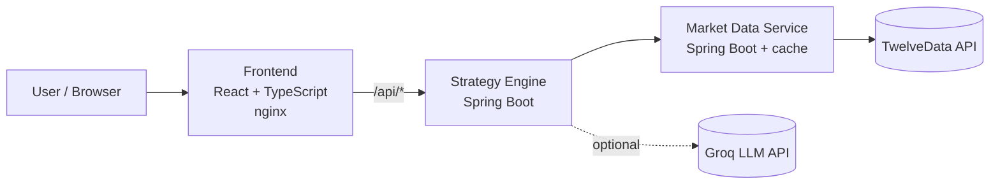

# Sentinel AI Trading Lab ☸️📈


A cloud-native trading strategy lab built with **Spring Boot microservices**, a **React + TypeScript** dashboard, and a **Docker / Kubernetes / Helm** deployment.

Analyze stock behavior, run EMA and Fair Value Gap strategies, combine them into a consensus signal, backtest them with real trade mechanics and risk metrics, and get a plain-language AI explanation of the results.


> **Disclaimer:** Sentinel is an educational and analytical project. It does not place orders and nothing it produces is financial advice.

---

## Table of Contents

- [Features](#features)
- [Architecture](#architecture)
- [Tech Stack](#tech-stack)
- [How It Works](#how-it-works)
- [Quick Start](#quick-start)
- [Kubernetes Deployment](#kubernetes-deployment)
- [Configuration](#configuration)
- [API Reference](#api-reference)
- [Testing and CI](#testing-and-ci)
- [Design Decisions](#design-decisions)
- [Known Limitations](#known-limitations)
- [Roadmap](#roadmap)
- [Project Structure](#project-structure)
- [License](#license)

---

## Features

### Market visualization
- Candlestick-style price view with volume
- EMA overlays
- Multiple timeframes (1 day, 1 week, 1 month)

### Strategy playground
Run indicators on historical data with configurable parameters.

| Strategy | Description |
| --- | --- |
| **EMA** | Configurable fast and slow exponential moving averages; bullish when fast is above slow |
| **FVG** | Fair Value Gap: a three-candle imbalance where the third candle's low sits above the first candle's high |

Each strategy returns whether a pattern was detected and a confidence score:

```json
{ "pattern": "ema", "detected": true, "confidence": 92 }
```

### Sentinel Consensus
Combines multiple strategies into a single recommendation.

```json
{
  "ema": "BUY",
  "fvg": "BUY",
  "agreement": 100,
  "recommendation": "STRONG BUY",
  "interval": "15min",
  "entryHint": "Entry: next 15-minute candle open."
}
```

- Both strategies agree: `agreement = 100`, **STRONG BUY**
- Only one fires: `agreement = 50`, **WAIT**
- Neither fires: `agreement = 0`, **NO SIGNAL**

`entryHint` only reads as an entry instruction when the recommendation is actionable. Otherwise it states that nothing was confirmed, so the dashboard never implies a trade that did not exist.

### Backtesting
Simulates a strategy with real trade mechanics rather than closing every trade after a single candle. Each signal opens a position with a configurable **stop-loss** and **take-profit**, held for up to a configurable **maximum holding period**.

Reported metrics:

- Trades, wins, losses, win rate
- Profit factor (gross profit ÷ gross loss, in currency)
- Total return % and a **buy-and-hold benchmark** for the same period
- Max drawdown %
- Sharpe ratio
- Expectancy per trade
- Full trade history (entry, exit, exit reason, P&L %)
- Equity curve rendered alongside price action, with entries and exits plotted on the chart (blue = entry, green = winning exit, red = losing exit)

```json
{
  "strategy": "ema",
  "trades": 80,
  "wins": 30,
  "losses": 50,
  "winRate": 37.5,
  "profitFactor": 1.17,
  "totalReturnPct": 18.11,
  "benchmarkReturnPct": 174.75,
  "maxDrawdownPct": 15.23,
  "sharpeRatio": 1.36,
  "expectancy": 22.64
}
```

### AI Insight
Turns a backtest and consensus result into a plain-language summary, for example: *"This strategy underperformed buy-and-hold, driven mainly by early take-profit exits during a strong uptrend."*

- Uses Groq's free-tier inference API (Llama 3.3 70B) when `GROQ_API_KEY` is set.
- The prompt is grounded in the computed numbers (win rate, profit factor, drawdown, benchmark comparison). The model is instructed to interpret those figures only, not to invent predictions, news, or targets.
- Falls back to a deterministic, dependency-free **rule-based summary** if no key is configured or the call fails, so the feature never breaks the app.
- Every response is tagged `"source": "AI"` or `"source": "RULE_BASED"`.

---

## Architecture



| Component | Responsibility |
| --- | --- |
| **Frontend** | Dashboard, charts, strategy playground. Served by nginx, which also reverse-proxies `/api/` to the strategy engine |
| **Strategy Engine** | Strategies, consensus, backtesting, AI insight, chart data |
| **Market Data Service** | Owns the external market API, API key, and an in-memory TTL cache |

---

## Tech Stack

| Layer | Technologies |
| --- | --- |
| Frontend | React, TypeScript, Vite, Axios, Recharts, CSS |
| Backend | Java 21, Spring Boot, Spring Boot Actuator |
| AI | Groq API (Llama 3.3 70B) with rule-based fallback |
| Testing | JUnit 5, Mockito |
| DevOps | Docker, Docker Compose, Kubernetes (Kind), Helm, GitHub Actions |

---

## How It Works

**Request flow (backtest example):**

1. The dashboard sends `POST /api/strategy/backtest/ema/AAPL`.
2. In Kubernetes, nginx proxies the call to the strategy engine.
3. The strategy engine requests candles from the market data service over HTTP.
4. The market data service returns cached candles, or fetches from TwelveData on a cache miss.
5. The engine resolves the strategy by name, runs the backtest, and returns metrics, trade history, and the equity curve.

**Backtest engine:** walks forward through the candles. At each step the strategy only sees candles *before* that point, so there is no look-ahead in signal generation. A signal opens a long position; the engine then scans forward until the stop-loss hits, the take-profit hits, or the maximum holding period expires. If the stop and target are both reachable within one candle, the stop is assumed to hit first (the pessimistic assumption). Capital compounds from trade to trade.

**Extensibility:** strategies implement a `TradingStrategy` interface and are registered as Spring components. A `StrategyResolver` collects them and looks them up by name, so adding a strategy is a single new class with no controller changes.

---

## Quick Start

### Prerequisites
- Java 21, Docker, and Docker Compose
- A free [TwelveData](https://twelvedata.com) API key
- (Optional) A free [Groq](https://console.groq.com) API key for AI insights

### 1. Configure environment variables
```bash
cp .env.example .env
# edit .env and fill in your keys
```

### 2. Build the backend services
```bash
cd backend/market-data-service && ./mvnw clean package
cd ../strategy-engine && ./mvnw clean package
cd ../..
```

### 3. Start everything
```bash
docker compose up --build
```

Open **http://localhost:5173**.

---

## Kubernetes Deployment

Two paths are provided for a local [Kind](https://kind.sigs.k8s.io/) cluster: the **Helm chart** (recommended, fully parameterized) and **raw manifests** (simple, older).

### 1. Build images and load them into Kind
```bash
kind create cluster --name sentinel

docker build -t sentinel-ai-trading-lab-market-data ./backend/market-data-service
docker build -t sentinel-ai-trading-lab-strategy-engine ./backend/strategy-engine
docker build -t sentinel-ai-trading-lab-frontend ./frontend/sentinel-ui

kind load docker-image sentinel-ai-trading-lab-market-data --name sentinel
kind load docker-image sentinel-ai-trading-lab-strategy-engine --name sentinel
kind load docker-image sentinel-ai-trading-lab-frontend --name sentinel
```

### 2a. Deploy with Helm (recommended)
```bash
helm install sentinel ./helm/sentinel \
  --set secrets.twelveDataApiKey=$TWELVEDATA_API_KEY \
  --set secrets.groqApiKey=$GROQ_API_KEY
```

Upgrade after a code change (rebuild and reload the image first):
```bash
helm upgrade sentinel ./helm/sentinel \
  --set secrets.twelveDataApiKey=$TWELVEDATA_API_KEY \
  --set secrets.groqApiKey=$GROQ_API_KEY
```

Uninstall:
```bash
helm uninstall sentinel
```

All tunables (replica counts, ports, cache TTL, model name) live in `helm/sentinel/values.yaml`. Override them with `--set` or a custom values file. Secrets are rendered into a Kubernetes Secret at install time and consumed through `secretKeyRef`; they are never stored in `values.yaml`.

### 2b. Deploy with raw manifests
```bash
kubectl apply -R -f k8s/
```
> This path predates the AI Insight and caching features and does not set `GROQ_API_KEY` or the cache variables. AI Insight will fall back to its rule-based summary. Use Helm for the full feature set.

### 3. Verify and access
```bash
kubectl get pods                                  # frontend, market-data, strategy-engine
kubectl port-forward service/frontend 5173:5173
```
Open **http://localhost:5173**.

A single port-forward is enough. The frontend's nginx reverse-proxies `/api/` to `strategy-engine` inside the cluster (see `frontend/sentinel-ui/nginx.conf.template`). This is deliberate: a browser cannot resolve Kubernetes-internal service names, only pods inside the cluster can.

Services expose Spring Boot Actuator probes at `/actuator/health`, used for readiness and liveness checks.

---

## Configuration

| Variable | Service | Default | Purpose |
| --- | --- | --- | --- |
| `TWELVEDATA_API_KEY` | market-data | `demo` | TwelveData API key |
| `TWELVEDATA_DEFAULT_OUTPUTSIZE` | market-data | `300` | Candles fetched when a caller does not specify |
| `TWELVEDATA_MAX_OUTPUTSIZE` | market-data | `500` | Server-side cap regardless of what is requested |
| `MARKET_DATA_CACHE_TTL_SECONDS` | market-data | `60` | TTL for the in-memory candle cache (protects the rate-limited free tier) |
| `MARKET_DATA_URL` | strategy-engine | `http://localhost:8080` | Location of the market data service |
| `GROQ_API_KEY` | strategy-engine | unset | Enables AI Insight; falls back to rule-based summary if unset |
| `GROQ_MODEL` | strategy-engine | `llama-3.3-70b-versatile` | Groq-hosted model to call |

Never commit real keys. `.env` is git-ignored; `.env.example` contains placeholders only.

---

## API Reference

Base URL (local): `http://localhost:8081`

### Strategy playground
```http
POST /api/strategy/playground/{strategy}/{symbol}
```
```json
{ "fast": 9, "slow": 21, "interval": "1day" }
```

### Backtest
```http
POST /api/strategy/backtest/{strategy}/{symbol}
```

### Consensus
```http
POST /api/strategy/consensus/{symbol}
```

### AI insight
```bash
curl -X POST http://localhost:8081/api/strategy/insight/ema/AAPL \
  -H "Content-Type: application/json" \
  -d '{"interval":"1day"}'
```

### Observability
```http
GET /actuator/health
GET /actuator/info
```

---

## Testing and CI

Unit tests (JUnit 5 + Mockito) cover the consensus logic, strategy resolver, chart service, and backtest service.

```bash
cd backend/strategy-engine && ./mvnw test
cd backend/market-data-service && ./mvnw test
```

**GitHub Actions** (`.github/workflows/ci.yml`) runs on every push to `main` and on pull requests:

- Backend tests for both services (matrix build, Java 21, Maven cache)
- Frontend install and production build (Node 20, `tsc -b && vite build`)

---

## Design Decisions

- **Two backend services.** The market data service owns the third-party dependency, the API key, and the cache. The strategy engine is pure computation. Providers can be swapped without touching strategy code.
- **Strategy pattern.** New strategies are one class each, discovered by Spring and resolved by name.
- **Provider abstraction.** Market data is read through a `StockDataProvider` interface, so TwelveData can be replaced and the service layer can be tested with mocks.
- **Graceful AI degradation.** AI insight sits behind an `InsightGenerator` interface with an LLM implementation and a deterministic fallback, so an outage or missing key never breaks the API.
- **TTL cache.** A `ConcurrentHashMap` with expiring entries keyed by symbol, interval, and output size reduces calls to a rate-limited API.
- **nginx as the single entry point.** Serves the static build and proxies `/api/`, which avoids CORS and works around the browser's inability to resolve cluster-internal DNS.
- **Helm for configuration.** One chart parameterizes images, ports, replicas, cache TTL, and secrets.

---

## Known Limitations

Sentinel is built for learning and exploration, not live trading:

- Backtests are **long-only** with full-capital sizing per trade, and include **no fees or slippage**.
- Entries are modeled at the **close** of the signal candle, which is slightly optimistic compared with a realistic fill.
- The Sharpe ratio is computed from per-trade returns and annualized with √252, which is an approximation. A per-bar equity-curve Sharpe would be more rigorous.
- The data window is limited (a few hundred candles), and there is no out-of-sample or walk-forward validation.
- The cache is in-memory per instance and has no size-based eviction, so multiple replicas do not share it. Redis or Caffeine would address this.
- Outbound HTTP calls do not yet have explicit timeouts or a circuit breaker.

---

## Roadmap

- Redis or Caffeine caching
- Timeouts and circuit breakers on outbound calls (Resilience4j)
- Transaction costs, position sizing, and shorting in the backtester
- Live streaming candles and WebSocket updates
- Replay mode
- More indicators
- Alerts
- Authentication

---

## Project Structure

```
sentinel-ai-trading-lab/
├── .github/workflows/     # CI: backend tests, frontend build
├── backend/
│   ├── market-data-service/   # external API, caching
│   └── strategy-engine/       # strategies, consensus, backtest, AI insight
├── frontend/
│   └── sentinel-ui/           # React + TypeScript dashboard, nginx config
├── helm/sentinel/         # Helm chart (recommended)
├── k8s/                   # raw Kubernetes manifests
├── docs/                  # diagrams and screenshots
├── docker-compose.yml
├── .env.example
└── README.md
```

---

## License

Released under the [MIT License](LICENSE).